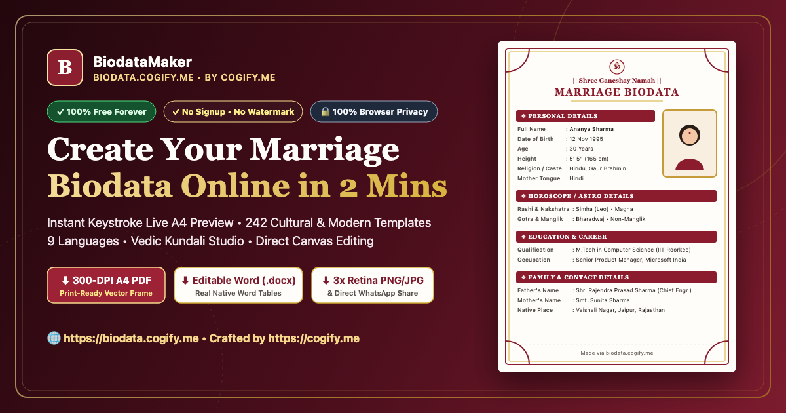
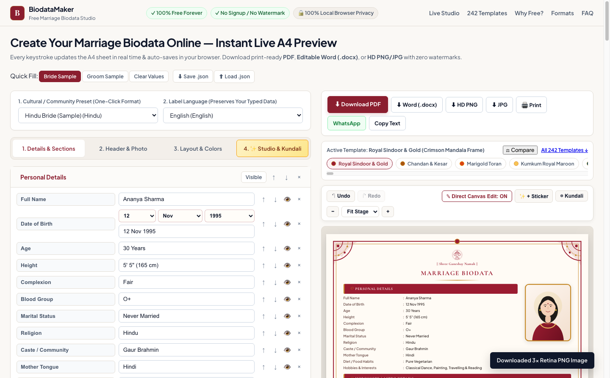
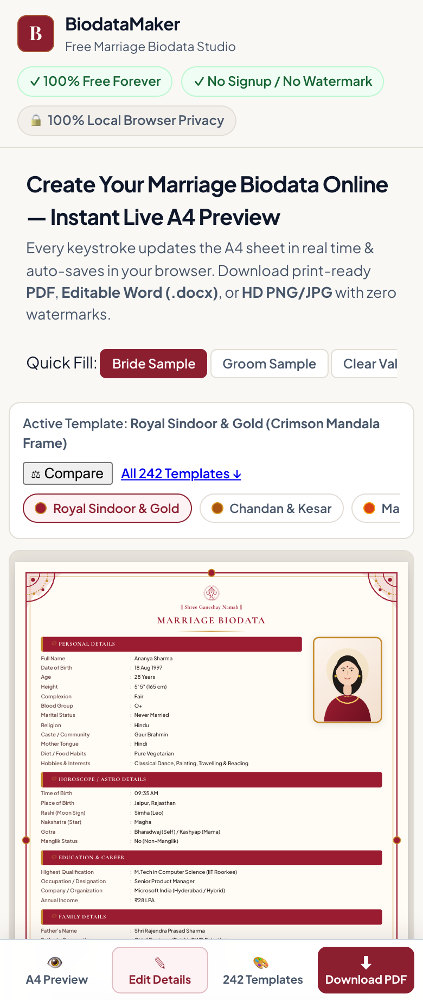
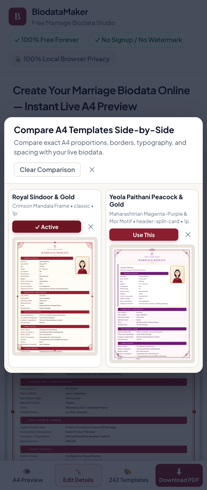

<div align="center">

<a href="https://biodata.cogify.me">
  
</a>

<br />

# 🕉️ Shubh Vivah Biodata Studio

### **The #1 Global Free Online Marriage Biodata Maker & Matrimonial Profile Studio**
**242+ Handcrafted Cultural Templates · 14 Structural A4 Layouts · Instant 300 DPI PDF, PNG, Editable Word (`.docx`) & WhatsApp Export**

[](https://biodata.cogify.me)
[](https://cogify.me)
[](https://biodata.cogify.me/#templates-section)
[](https://biodata.cogify.me/#privacy)
[](https://biodata.cogify.me)

**[🚀 Launch Live Biodata Maker (`biodata.cogify.me`)](https://biodata.cogify.me)** · **[🎨 Browse 242+ Templates](https://biodata.cogify.me/#templates-section)** · **[❓ Matrimonial FAQ](https://biodata.cogify.me/#faq-section)** · **[🌐 Built by Cogify.me](https://cogify.me)**

</div>

---

## ✨ Overview

**Shubh Vivah Biodata Studio** ([biodata.cogify.me](https://biodata.cogify.me)) is a fast, 100% client-side, privacy-first **Online Marriage Biodata Maker** engineered by **[Cogify.me](https://cogify.me)**. Designed for Indian, South Asian, and global NRI families across **India, USA, UK, Canada, UAE, Australia, and Singapore**, it combines traditional cultural authenticity (Hindu, Muslim/Nikah, Sikh/Anand Karaj, Jain, Christian, Buddhist, Marathi, Gujarati, Bengali, South Indian, and Modern NRI Executive styles) with an interactive **Canva-style Studio Editor** and **1:1 Print-Perfect A4 Exports**.

Unlike commercial biodata generators that trap users behind last-step paywalls, watermark downloads, or upload sensitive family details and horoscope photographs to third-party servers, **Shubh Vivah Biodata Studio** runs entirely in your browser and exports clean, watermark-free **300 DPI Print-Ready A4 PDF**, **High-Resolution PNG**, **Editable Microsoft Word (`.docx`)**, and **Formatted WhatsApp Summaries** for free.

---

## 📸 Product Screenshots

| 🖥️ Desktop Studio & Real-Time A4 Preview | 📄 Exported 300 DPI Print-Ready A4 Biodata |
| :---: | :---: |
|  |  |
| *Interactive 3-tab form & Canva Studio with real-time 210mm × 297mm A4 preview* | *Exact 1:1 vector border frame, sacred header emblem, portrait & structured columns* |

| 📱 Mobile-First Responsive Workspace | ⚖️ Side-by-Side A4 Template Comparison |
| :---: | :---: |
|  |  |
| *Dedicated mobile workspace with proportionally scaled A4 sheet modal* | *Compare up to 3 marriage biodata templates side by side with your live details* |

---

## 🏆 Why Shubh Vivah Biodata Studio Ranks #1 Globally

| Feature / Capability | **Shubh Vivah (`biodata.cogify.me`)** | Typical Paid Biodata Sites | Generic Word / Canva Templates |
| :--- | :---: | :---: | :---: |
| **Pricing & Watermarks** | **100% Free · Zero Watermark** | ₹99–₹299 paywall at download | Paid Pro assets / manual layout |
| **Signup / Phone OTP Required** | **No Login / No OTP Required** | Mandatory email or phone OTP | Account signup required |
| **Data Privacy Architecture** | **100% Browser-Local (Zero Server Uploads)** | Stores personal & family data in DB | Cloud-stored documents |
| **Curated Matrimonial Templates** | **242+ Templates across 14 A4 Layouts** | 10–25 repetitive single-column skins | Unstructured freeform canvas |
| **Smart DOB & Age Calculator** | **Dedicated Day/Month/Year + Auto Years Age** | Manual text entry or broken native pickers | Manual calculation |
| **Astrology & Kundali Pickers** | **Built-in Rashi (12), Nakshatra (27), Manglik, Gotra** | Basic text boxes | None |
| **Export Formats** | **300 DPI PDF, PNG, Word (`.docx`), WhatsApp, JSON** | PDF or low-res JPG only | PDF/PNG only |
| ** Preview-to-Export Fidelity** | **Exact 1:1 A4 (794×1123px) Raster + Vector Pipeline** | Misaligned fonts & clipped borders | Varies |
| **Automatic Session Recovery** | **Silent Chunked Cookies + LocalStorage Backup** | Lost on refresh unless logged in | Cloud account required |

---

## 🎨 14 Structural A4 Layout Architectures & 31 SVG Ornamental Frames

Every template in **Shubh Vivah Biodata Studio** is built on a locked **210mm × 297mm (794px × 1123px @ 96 DPI)** A4 print canvas that scales proportionally on any screen without reflowing or distorting columns.

| # | Layout Architecture ID | Structural Geometry | Best Suited For |
| :-: | :--- | :--- | :--- |
| 1 | `classic-single` | Traditional single-column key-value table with right-aligned portrait | Classic Hindu, Marathi, Gujarati & family elders |
| 2 | `two-column-grid` | Balanced 2-column section cards below a full-width header banner | Detailed profiles with Horoscope + Career + Family |
| 3 | `sidebar-left` | Left profile/contact/astro sidebar + right main biography column | Modern IT, Medical, Engineering & Executive profiles |
| 4 | `sidebar-right` | Main biography column on left + highlighted portrait/astro sidebar on right | Contemporary Bride & Groom profiles |
| 5 | `editorial-split` | Magazine-inspired asymmetric split with bold serif typography | NRI & cosmopolitan families |
| 6 | `minimal-card` | Clean swiss-grid card blocks with subtle hairline dividers | Minimalist, no-frills modern matrimonial biodata |
| 7 | `boxed-sections-grid` | Ornamental bordered cards for each section in a structured grid | High-density family & kundali profiles |
| 8 | `timeline-spine` | Vertical golden heritage spine connecting sections chronologically | Academic, civil services & career-focused biodata |
| 9 | `royal-centered-crest` | Centered royal medallion portrait & symmetrical dual-column body | Rajwadi, Marwari, Punjabi & Royal Wedding themes |
| 10 | `two-page-comprehensive` | Extended multi-section layout optimized for 1–2 A4 pages | Elaborate joint-family & detailed partner expectations |
| 11 | `kundali-horoscope-focus` | Dedicated Vedic astrology & Janam Kundali highlight ribbon | Traditional Vedic / Jyotish priority matchmaking |
| 12 | `arched-palace-darbar` | Mughal / Rajasthani Jharokha arch header with palace pillar frame | Royal Darbar, Nikah Nama & Heritage Zari designs |
| 13 | `magazine-cover-spread` | Editorial cover masthead with refined callout badges | Designer bridal & groom portfolio biodata |
| 14 | `modern-infographic-resume` | Scannable pill tags, quick-fact highlights & structured blocks | Global NRI (USA, UK, Canada, UAE, Australia) |

---

## 🌍 Pre-Rendered Community & Regional Landing Pages (SEO & GEO)

The production build (`npm run build`) automatically pre-renders **15 dedicated static HTML landing routes** with tailored `<title>`, `<meta name="description">`, canonical URLs, Open Graph tags, and Schema.org structured data:

- [`/hindu-marriage-biodata`](https://biodata.cogify.me/hindu-marriage-biodata) — **Hindu Marriage Biodata Maker** (Vedic Rashi, Nakshatra, Gotra, Nadi, Gan & Shree Ganeshaya Namah headers)
- [`/muslim-nikah-biodata`](https://biodata.cogify.me/muslim-nikah-biodata) — **Muslim Nikah Biodata Maker** (Bismillah calligraphy header, Sect/Maslak, Deen & Wali contact details)
- [`/sikh-marriage-biodata`](https://biodata.cogify.me/sikh-marriage-biodata) — **Sikh Anand Karaj Marriage Biodata Maker** (Ik Onkar emblem, Gursikh family & Punjabi heritage frames)
- [`/christian-marriage-biodata`](https://biodata.cogify.me/christian-marriage-biodata) — **Christian Matrimony Biodata Maker** (Sacred Cross emblem, Denomination, Parish & Church details)
- [`/jain-marriage-biodata`](https://biodata.cogify.me/jain-marriage-biodata) — **Jain Marriage Biodata Format** (Jai Jinendra header, Shwetambar/Digambar & Sampradaya layouts)
- [`/marathi-marriage-biodata`](https://biodata.cogify.me/marathi-marriage-biodata) — **Marathi Lagnaacha Biodata Maker** (मराठी लग्नाचा बायोडाटा — Kuldaivat, Devak, Mamakul, Nadi & Gan)
- [`/gujarati-marriage-biodata`](https://biodata.cogify.me/gujarati-marriage-biodata) — **Gujarati Lagna Biodata Format** (ગુજરાતી લગ્ન બાયોડેટા — Native Place/Vatan, Mosal, Gnati & Gotra)
- [`/hindi-shadi-biodata`](https://biodata.cogify.me/hindi-shadi-biodata) — **Hindi Shadi Biodata Maker** (हिंदी शादी बायोडाटा मेकर — श्री गणेशाय नमः, कुंडली, गोत्र और परिवार)
- [`/tamil-marriage-biodata`](https://biodata.cogify.me/tamil-marriage-biodata) — **Tamil Thirumana Biodata Maker** (தமிழ் திருமண பயோடேட்டா — Kuladeivam, Gothram, Rasi & Natchathiram)
- [`/telugu-marriage-biodata`](https://biodata.cogify.me/telugu-marriage-biodata) — **Telugu Pellichoopulu Biodata Maker** (తెలుగు పెళ్లి బయోడేటా — Gothram, Raasi, Nakshatram & Padam)
- [`/bengali-marriage-biodata`](https://biodata.cogify.me/bengali-marriage-biodata) — **Bengali Biyer Biodata Maker** (বাংলা বিয়ের বায়োডাটা — Shree Shree Prajapataye Namah, Rashi & Gana)
- [`/nri-executive-biodata`](https://biodata.cogify.me/nri-executive-biodata) — **Modern NRI & Executive Marriage Biodata Maker** (USA, UK, Canada, Australia, UAE & Singapore)
- [`/biodata-for-marriage-pdf`](https://biodata.cogify.me/biodata-for-marriage-pdf) — **300 DPI Print-Ready Marriage Biodata PDF Maker**
- [`/biodata-word-format`](https://biodata.cogify.me/biodata-word-format) — **Editable Microsoft Word (`.docx`) Marriage Biodata Format**
- [`/whatsapp-biodata-maker`](https://biodata.cogify.me/whatsapp-biodata-maker) — **WhatsApp Marriage Biodata & HD Image Card Generator**

---

## ⚡ Performance, SEO & Generative Engine Optimization (GEO) Architecture

- **Compact, Fast-Loading HTML (`< 500 lines`)**: Semantic HTML5 structure with below-the-fold `content-visibility: auto` rendering optimization.
- **Lazy-Loaded Export Vendors**: Heavy document generation engines (`html2canvas`, `jspdf`, `docx`) are dynamically imported on demand (`import()`) only when the user clicks an export button—cutting initial JavaScript execution weight by **>75%** (`index.js` is just ~74 KB gzipped).
- **Complete Search & AI Crawlability Suite**:
  - [`public/robots.txt`](public/robots.txt) — Explicit allow rules for Googlebot, Bingbot, Applebot, GPTBot, OAI-SearchBot, ClaudeBot, PerplexityBot, and Google-Extended.
  - [`public/sitemap.xml`](public/sitemap.xml) & [`public/sitemap.xsl`](public/sitemap.xsl) — XML Sitemap with `xhtml:link` international `hreflang` annotations (`en-IN`, `en-US`, `en-GB`, `en-CA`, `en-AU`, `en-AE`, `en-SG`, `x-default`) and image sitemap metadata.
  - [`public/llms.txt`](public/llms.txt) & [`public/llms-full.txt`](public/llms-full.txt) — Structured knowledge files for AI search engines (ChatGPT Search, Perplexity, Claude, Google AI Overviews).
  - **Schema.org `@graph` JSON-LD**: Integrated `WebSite`, `Organization` ([Cogify.me](https://cogify.me)), `WebApplication`, `SoftwareApplication`, `HowTo`, `ItemList`, `BreadcrumbList`, and `FAQPage` structured data.
  - [`public/_headers`](public/_headers) — Edge security headers (`X-Content-Type-Options`, `X-Frame-Options`, `Referrer-Policy`) and immutable 1-year cache headers for hashed Vite bundles.

---

## 🛠️ Local Development, Testing & Production Build

### Prerequisites
- **Node.js** `>= 20.x` (tested on Node `v24.20.0`)
- **npm** `>= 10.x`

### 1. Install Dependencies
```bash
npm install
```

### 2. Start Local Development Server
```bash
npm run dev
```

### 3. Run the 20-Suite Quality Assurance & SEO Test Suite
```bash
npm test
```

### 4. Build for Production (Vite + Static SEO Route Generator)
```bash
npm run build
```
This compiles optimized client bundles into `dist/` and runs [`scripts/generate-seo-pages.mjs`](scripts/generate-seo-pages.mjs) to pre-render all 15 static community landing pages (`dist/<slug>/index.html`).

### 5. Cloudflare R2 (`biodata` Bucket) & D1 (`biodata` Database) Download Archiving
Every time a user downloads their biodata (PDF, PNG/JPG, Word `.docx`, or JSON), the Cloudflare Worker (`src/worker.js` + `src/server/cloudflareArchive.js`) automatically archives:
1. **Cloudflare R2 Bucket (`biodata`, binding `BIODATA_BUCKET`)** — Directly inside the `biodata/` folder (`biodata/<candidate-slug>_<timestamp>_<id>/` and `biodata/latest/<candidate-slug>/`):
   - `<slug>-biodata.pdf` — Exact 300 DPI A4 PDF binary
   - `<slug>-photo.<jpg|png|webp|svg>` — Candidate profile photo binary (when included)
   - `<slug>-data.json` — Complete candidate JSON snapshot (all sections, fields, template, and photo)
2. **Cloudflare D1 Database (`biodata`, ID `bb855f1e-d450-464d-b4da-f273c821288e`, binding `DB`)**:
   - `biodata_downloads` — Every download event with sortable columns (`candidate_name`, `date_of_birth`, `age_years`, `religion`, `caste`, `gotra`, `rashi`, `nakshatra`, `manglik`, `education`, `occupation`, `income`, `work_location`, `father_name`, `mother_name`, `native_place`, `contact_phone`, `contact_email`, `r2_folder_path`, `r2_pdf_key`, `r2_photo_key`, `r2_json_key`, `created_at`)
   - `biodata_candidates` — Deduplicated candidate directory indexed by `candidate_fingerprint`

```bash
# Verify & seed local D1 SQLite + R2 folder structure
npm run db:setup

# Query & sort archived D1 downloads (by created_at, age_years, candidate_name_lower, religion, etc.)
npm run db:list

# Apply D1 SQL schema migration to remote Cloudflare D1
npm run d1:migrate:remote

# Deploy Worker + Static Assets + R2 + D1 bindings to Cloudflare
npx wrangler deploy
```

---

## 📂 Repository Structure

```text
BioData/
├── index.html                        # Compact (<500 lines) semantic entry with JSON-LD @graph & hreflang
├── wrangler.jsonc                    # Cloudflare Worker + Static Assets + R2 (biodata) + D1 (biodata) config
├── vite.config.js                    # Vite 6 production build & local R2/D1 middleware for dev/preview
├── migrations/
│   └── 0001_init_biodata_tables.sql  # Cloudflare D1 SQL schema & sorting indexes
├── scripts/
│   ├── generate-seo-pages.mjs        # Post-build static HTML pre-renderer for 15 SEO landing routes
│   ├── setup-cloudflare-d1-r2.mjs    # Initializes & verifies D1 tables + R2 biodata/ folder structure
│   └── query-d1-downloads.mjs        # CLI tool to sort/filter D1 biodata_downloads & biodata_candidates
├── public/
│   ├── og-banner.png                 # 1200×630 Open Graph & Twitter Summary Large Image banner
│   ├── favicon.svg                   # Sacred Ganesh & Gold Lotus vector icon
│   ├── robots.txt                    # Search & AI crawler directives
│   ├── sitemap.xml                   # International hreflang + image XML sitemap
│   ├── sitemap.xsl                   # Human-readable XSL stylesheet for sitemap.xml
│   ├── llms.txt                      # Concise AI/LLM discovery manifest
│   ├── llms-full.txt                 # Comprehensive AI/LLM technical & cultural reference
│   ├── site.webmanifest              # PWA manifest
│   ├── _headers                      # Cloudflare edge caching & security headers
│   └── screenshots/                  # Verified desktop, mobile, compare & exported A4 screenshots
├── src/
│   ├── main.js                       # Interactive editor, live A4 preview, modals & Canva Studio
│   ├── worker.js                     # Cloudflare Worker entry (/api/archive-download, /api/downloads, /api/r2/*)
│   ├── server/
│   │   └── cloudflareArchive.js      # R2 folder uploader (PDF + photo + JSON) & D1 SQL table archiver
│   ├── seo/
│   │   └── seoRouter.js              # 15 SEO landing route definitions & client hydration
│   ├── data/
│   │   ├── presets.js                # Default sections, DOB/age calculator, astro & preset schemas
│   │   ├── templates.js              # 242+ verified matrimonial templates across 14 A4 layouts
│   │   ├── canvaElements.js          # Religious emblems, stickers, textures & kundali presets
│   │   └── canvaCatalog.js           # Curated heritage & modern design catalog metadata
│   ├── utils/
│   │   ├── exporters.js              # Lazy-loaded 1:1 A4 PDF, PNG, Word (.docx), WhatsApp & R2/D1 archiver
│   │   └── cookies.js                # Automatic chunked browser cookie + localStorage persistence
│   └── styles/
│       └── main.css                  # Responsive workspace & strict 794×1123px A4 print stylesheet
└── tests/
    └── quality-assurance.test.mjs    # 21 automated end-to-end QA, template, export, SEO & R2/D1 assertions
```

---

## 🌐 About Cogify.me

**Shubh Vivah Biodata Studio** ([biodata.cogify.me](https://biodata.cogify.me)) is designed and engineered by **[Cogify.me](https://cogify.me)**. At **Cogify.me**, we build fast, privacy-first web applications, intelligent digital utilities, and modern cloud-native tools that run directly in your browser with zero server-side tracking.

- **Live Application**: [https://biodata.cogify.me](https://biodata.cogify.me)
- **Engineering Studio**: [https://cogify.me](https://cogify.me)
- **License**: MIT
